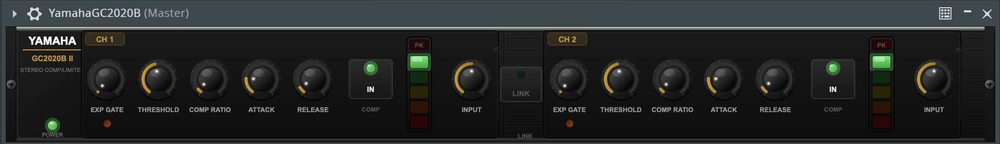

# Llamaja GC2020B II - Stereo Comp/Limiter

**Llamaja GC2020B II** is a dual-channel stereo compressor plugin inspired by classic hardware dynamics processors. It provides musical and practical dynamic control for modern mixing workflows, featuring exact VCA gain-computer modeling.

Developed in **C++17** using the **JUCE Framework (v7/v8)**.

## 🚀 Features

* **Dual-Channel Stereo Compression:** Two fully independent compressor channels (CH1 & CH2) ideal for dual-mono processing, with a **Stereo Link** mode to keep both channels responding together for mix buses.
* **Integrated Expander / Gate:** Dedicated EXP GATE section on each channel to reduce low-level noise and background bleed (perfect for drums and vocals).
* **Musical Dynamics Shaping:** Smooth compression for transparent leveling, or aggressive clamping for punch and control (Hard/Soft knee responses).
* **Hardware-Inspired Workflow:** Direct access to Threshold, Ratio, Attack, and Release with zero latency design.
* **Visual Metering:** LED-style gain-reduction and peak activity meters provide fast visual feedback.
* **Robust DSP:** Internal floating-point processing with Thread-Safe APVTS parameter handling to prevent zippering during automation.

## 🛠️ Technical Specifications

* **Format:** VST3, AU, Standalone
* **OS Compatibility:** macOS (11.0+, Intel & Apple Silicon), Windows (64-bit)
* **Sample Rates:** 44.1kHz to 192kHz
* **Channels:** Dual Mono / Stereo Linked

## ⚙️ Installation & Build

### Download Pre-compiled Binaries
You can download the latest `.zip` package for Mac or Windows from the [Releases page](../../releases). 
Move the extracted files to your system's VST3 or Components folder and rescan your DAW.

### Build from Source (CMake)
Run the following commands in your terminal:

    git clone https://github.com/DavidSignals/LlamajaGC2020B.git
    cd LlamajaGC2020B
    mkdir build && cd build
    cmake ..
    cmake --build . --config Release

## 🎛️ User Manual
For a detailed explanation of the core compression controls, practical mixing applications, and troubleshooting, please refer to the official [User Manual (PDF)](assets/LlamajaGC2020B.pdf).

## 👨‍💻 About the Developer
**David Rábago Félix (David Signals)**  
Audio Plugin Developer & Mechatronic Engineer specializing in C++ and DSP.  
* [GitHub](https://github.com/DavidSignals)
* [LinkedIn](https://www.linkedin.com/in/davidrabagofelix)